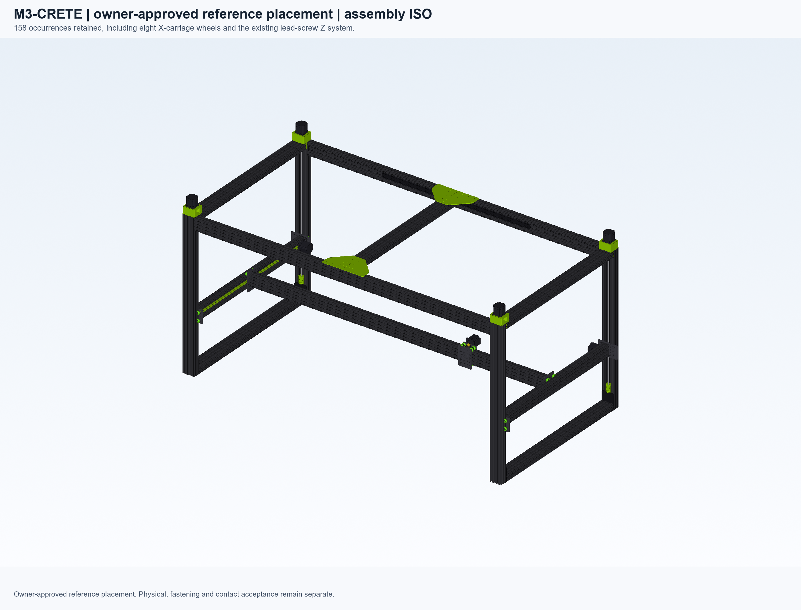
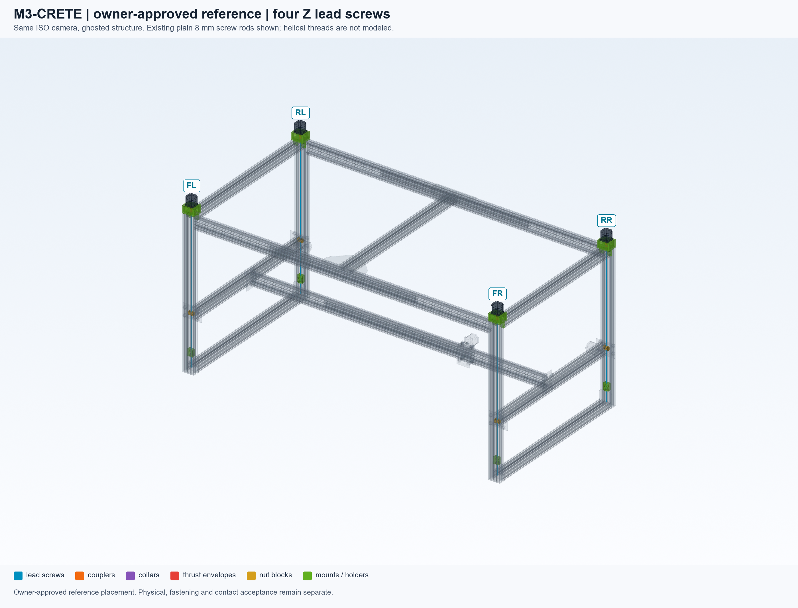
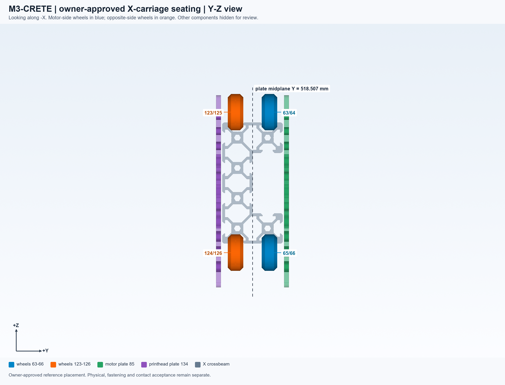
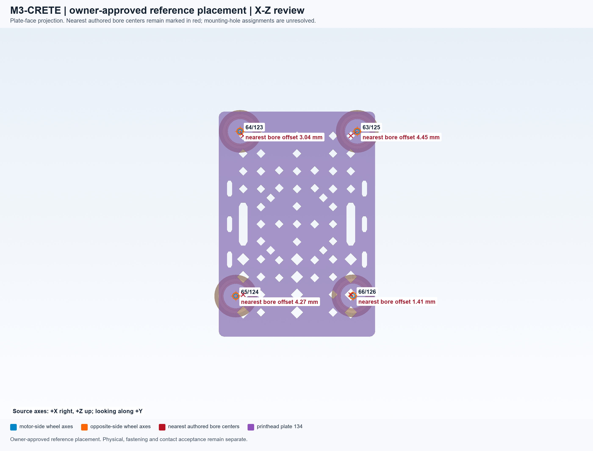

# M3-2 dual-plate X-carriage reference placement

Status: **reference placement approved by owner on 2026-10-22**. This reference retains
158 occurrences, 32 V-wheels, both X-carriage plates, and all four lead-screw
stacks. It is not an accepted manufacturing design or evidence of physical validation.

The owner clarified that the motor plate and the parallel printhead plate each
use four wheels. Only the existing authored `vwheel_123` through `vwheel_126`
receive rigid transforms. Each rotates -90 degrees about world Z to align its
axis with the existing Y-axis wheels. Its X/Z centre follows the corresponding
motor-side wheel, and its Y centre reflects that wheel through the midpoint of
the two authored plate centres, **Y = 518.507344538091 mm**.

That midpoint is an explicit review convention. No new spacer length, hole
pattern, preload, clearance, or connector mating criterion has been inferred.

| Wheel | Reference | Reference centre X, Y, Z (mm) | Nearest circular-hole centre offset (mm) |
|---|---|---|---|
| vwheel_123 | vwheel_64 | 1463.006642, 507.296947, 417.901456 | 3.043233 |
| vwheel_124 | vwheel_65 | 1460.513269, 507.296947, 324.877080 | 4.273885 |
| vwheel_125 | vwheel_63 | 1529.013155, 507.296947, 417.901456 | 4.446095 |
| vwheel_126 | vwheel_66 | 1526.584697, 507.296947, 325.000483 | 1.408579 |

Fastening fit is not established from the current evidence. The opposite-side
axle/spacer stack is not modeled. The table compares projected X/Z centres only;
the plates include slots and the existing hardware includes eccentric spacers.
These offsets do not establish a mounting defect or qualify machining.

Numerical checks on the saved reference preserve all geometry and colors, and
all other 154 poses. Strict CADCLAW source qualification covers all 158 flat and
XCAF solids. The comparable exact-interference subset reports 33 findings:
32 wheel/C-beam contacts and the unchanged motor_74/plate_85 overlap. The four
wheel/wheel and four wheel/plate findings from the original layout are absent.
No findings are waived and no global tolerance is changed. This subset does not
claim whole-machine interference or physical validation.

The motor/plate interface remains a fabrication-stage decision: plate clearance
for the shaft/body and washer or stand-off provision if needed. No hole pattern,
machining dimensions, or stand-off thickness is supplied or added here.

The lead screws remain the existing smooth 8 mm rod representation of Tr8x2
stock, not modeled helical threads. Their geometry and positions are unchanged.

The canonical generator now creates its root with `Assembly(name=...)`; passing
a positional name string previously exported an empty non-geometric container.
The reference uses CadQuery 2.7 / OCP 7.8 for export and CadQuery 2.8 / OCP 7.9
with the validated CADCLAW source for strict saved-artifact qualification.

Historical files, purchasing BOM, and firmware defaults are unchanged. The
earlier 154-part removal candidates and render attempts are superseded evidence.

## Review views

These views use the exact reference STEP. Lead screws are smooth rods without
modeled threads. Reference approval does not establish fastening fit, preload,
motor/plate clearance, or physical validation.

