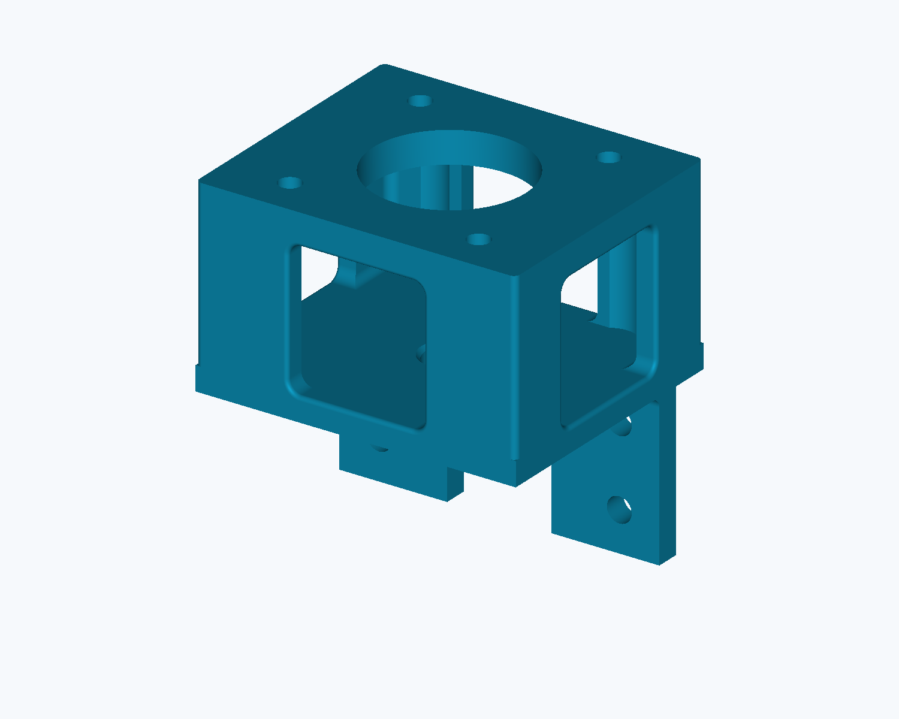

# Z motor mount reference files

**Open-access R2** is an owner-approved standalone component with a matching
STEP and STL exported directly from that STEP. The full M3-2 assembly retains
its older boxed mounts; the R2 part has not been placed or qualified in it.

| File | Revision and scope |
|---|---|
| [Open-access R2 STEP](Custom/Z_NEMA23_Leadscrew_Motor_Mount_Open_Access_2026-10-22_R2.step) | Editable analytic component. Original mounting holes, both bore chamfers and 80 x 68 x 86.5 mm envelope retained. |
| [Matching R2 STL](Custom/Z_NEMA23_Leadscrew_Motor_Mount_Open_Access_2026-10-22_R2.stl) | Binary mesh exported from the exact R2 STEP, in the same millimetre coordinates. |
| [R2 numerical record](Custom/Z_NEMA23_Leadscrew_Motor_Mount_Open_Access_2026-10-22_R2.validation.json) | Export settings, hashes and scoped numerical checks. |
| [Earlier owner-supplied STL](Custom/Z_NEMA23_Leadscrew_Motor_Mount_Open_Access_2026-10-22.stl) | Historical source for the access openings. Its tab, extra top ports and exterior rounding differ from R2; it is not the matching R2 mesh. |
| [Earlier repository GrokBot STEP](Custom/Z_NEMA23_Leadscrew_Motor_Mount_GrokBot.step) | Historical repository variant, distinct from the exact owner-supplied source bytes used for R2. |
| [Assembly mount STEP](Custom/Z_NEMA23_Leadscrew_Motor_Mount_M3-2.step) | Older boxed mount used in the unchanged full assembly. |
| [Full M3-2 assembly](https://media.githubusercontent.com/media/sunnyday-technologies/M3-CRETE/main/CAD/M3-2_Assembly.step) | 158 occurrences and 32 wheels; all four Z mounts remain the older boxed revision. |

R2 replaces the square opening corners and opens all four lateral sides with
34 x 34.1 mm throats, 3 mm profile radii and 1 mm outer edge relief. The three
interior ramps are replaced by the measured lower access cavity: a floor at
Z5.95 mm and 2 mm blends along the X inner-wall floor edges, using the original
authored cavity outline. The original mounting tab, top plate and hole pattern
remain. Two additional top ports in the earlier STL are intentionally absent.

The exact analytic source was the owner-supplied
`Z_NEMA23_Leadscrew_Motor_Mount.step` (450,001 bytes), SHA-256
`e46c190e61a94506bf2c0251881f77501f8a23e2566d1d76f1bb09f432ef0f98`.
The earlier repository GrokBot file is retained as history; it is not asserted
to be that exact source file.

Independent part-level checks confirmed a valid single solid, preserved frame,
12 cylindrical hole or partial slot-end surfaces, both conical bore chamfers,
edit locality and STEP round-trip preservation. Sampled lower-cavity agreement
with the aligned source mesh was within 0.0021 mm. The matching STL has no
boundary or nonmanifold edges; 512 sampled exact-native distances were below
0.00048 mm. These are numerical checks, not manufacturing tolerances or proof
of physical fit, strength or load capacity.

BOM item 24 remains **four mounts**. Purchasing quantities, prices, suppliers,
model selections and defaults are unchanged. Review assembly placement,
fastening, bearing/collar stack, coupler access and fabrication settings before
using this component. The original STEP tab differs from the assembly variant;
do not silently substitute R2 into the assembly.

## File identity

- R2 revision: `M3-Z-MOUNT-2026-10-22-R2`; released 2026-10-22.
- R2 STEP: 666,900 bytes; SHA-256 `07c2f9bd17dae59e7227500572d690f7756a3b0efd16de308b3ba478f2fd8471`.
- Matching R2 STL: 20,778,084 bytes; SHA-256 `b5aa4d1592a386076116c0cd03266b4adc907a0082cfc06818975c422ef3c09b`.
- Earlier STL: 3,181,384 bytes; SHA-256 `6188126a4883c11b4d997c93449d34c7c4d45f9db5427f7b43f63790dfb02be6`.
- Full assembly: 5,134,822 bytes; SHA-256 `5d47e7a30f8de56bfd48f221d8add15aa5c191b45dbb1ae017f6df1c7575cba7`.

The filename date is the release date. The [X-carriage review](X_CARRIAGE_REFERENCE_PLACEMENT.md)
retains the assembly contact, fastening and motor/plate findings. No physical or
whole-machine acceptance is established by this component release.
